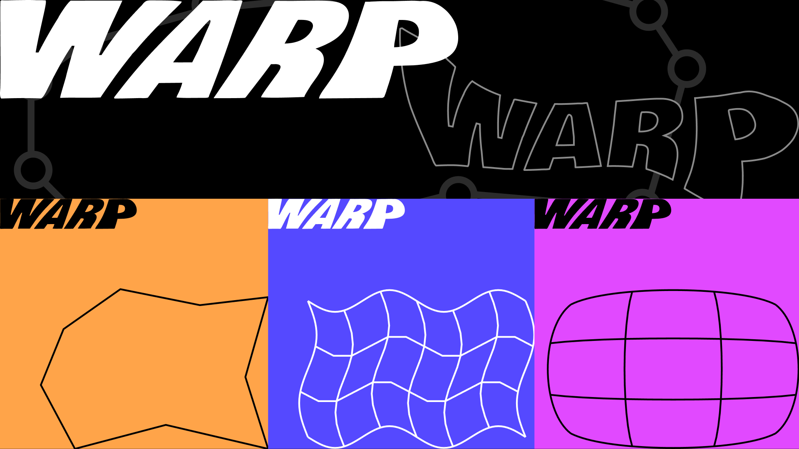

Warp vectors, images, etc! 

Allows transformation of vectors and images via interpolation functions from the MVC paper and the Polynomial Green Coordinates paper. Supports custom cages and perspective transforms.